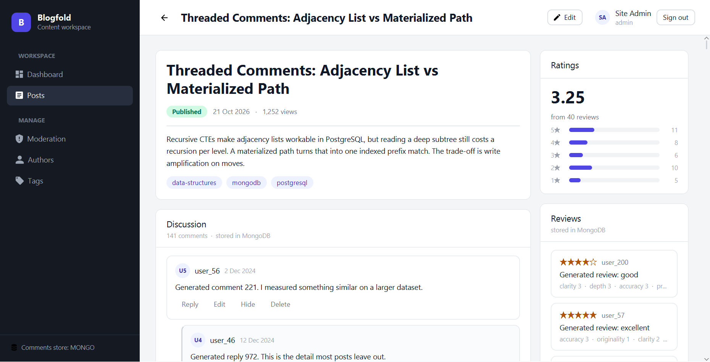
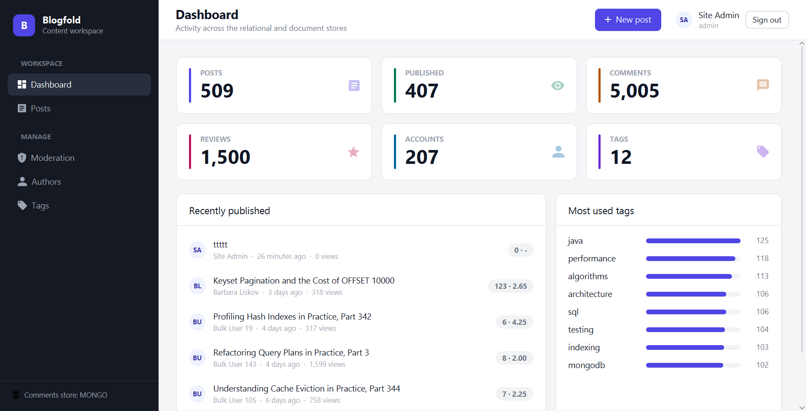
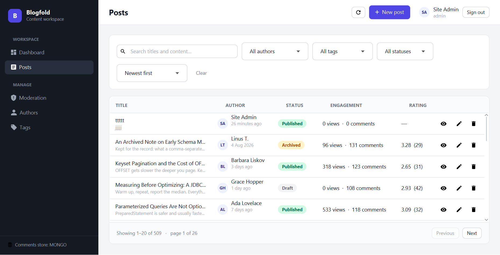
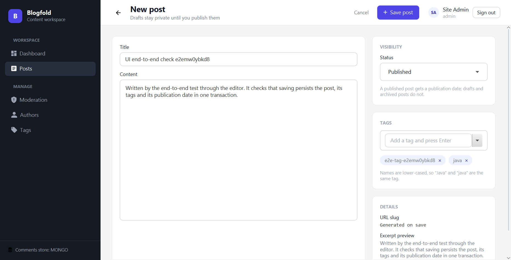
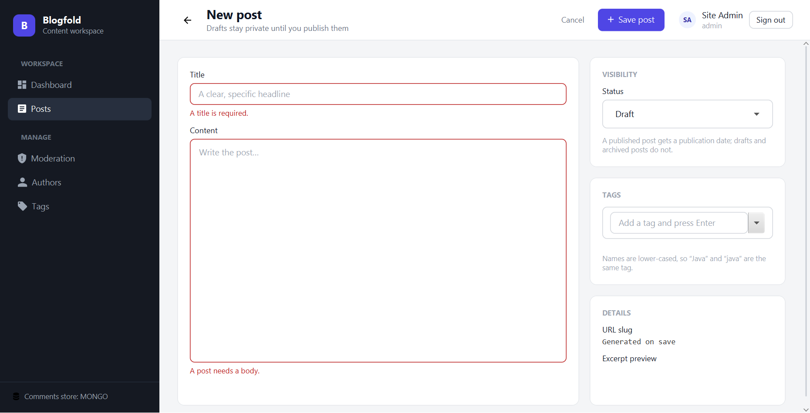
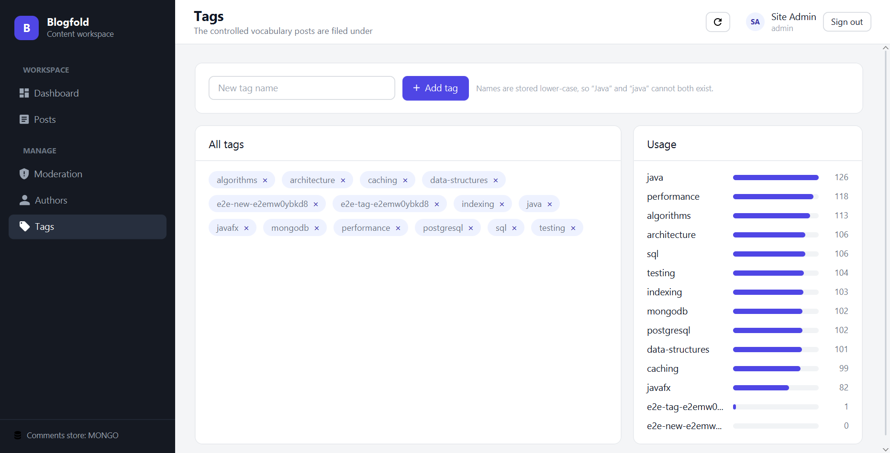
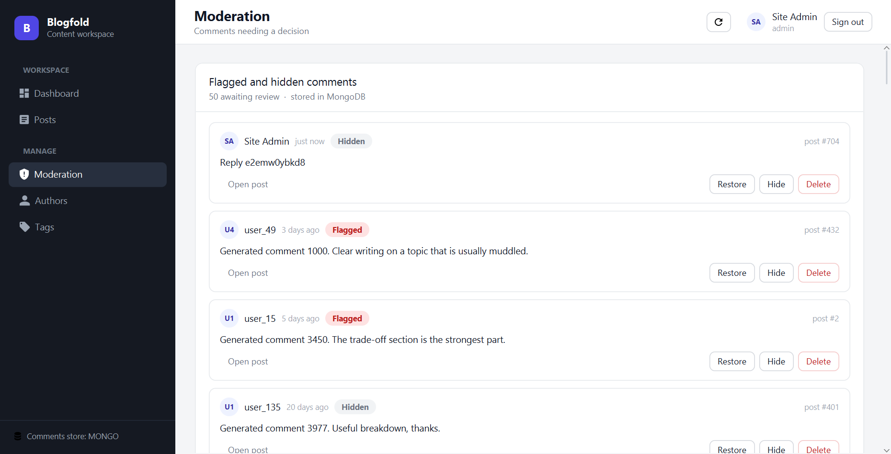
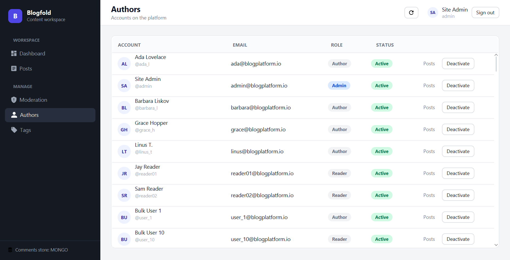
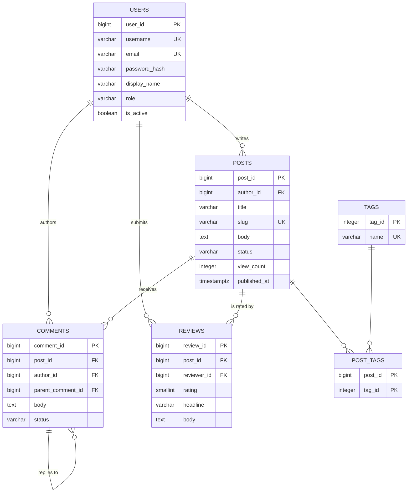

# Smart Blogging Platform

A desktop blogging application built with **JavaFX**. It stores users, posts and tags in
**PostgreSQL**, and comments and reviews in **MongoDB**. Through the interface you can
create, read, update and delete posts, comments, reviews and tags, and search, filter,
sort and page through posts. A dashboard shows analytics.

The project also covers the data-structures-and-algorithms part of the lab (hashing,
caching, sorting, searching, indexing). It measures the speed of every optimisation
before and after.



---

## Table of contents

1. [Screenshots](#1-screenshots)
2. [What the application does](#2-what-the-application-does)
3. [Sign in, sign up and roles](#3-sign-in-sign-up-and-roles)
4. [Requirements checklist](#4-requirements-checklist)
5. [Architecture](#5-architecture)
6. [Database design](#6-database-design)
7. [Data structures and algorithms](#7-data-structures-and-algorithms)
8. [Performance results](#8-performance-results)
9. [Setup and run](#9-setup-and-run)
10. [Testing](#10-testing)
11. [Project layout](#11-project-layout)
12. [Troubleshooting](#12-troubleshooting)

---

## 1. Screenshots

All screenshots show the real application. They are generated by the
end-to-end UI test (see [Testing](#10-testing)).

### Dashboard (analytics)
Counts of posts, published posts, comments, reviews, accounts and tags; the most
recently published posts; the most used tags.



### Post list (search, filters, sort, pagination)
Search by keyword, filter by author, tag and status, choose a sort order, and move
between pages with *Previous* / *Next*. Each row has buttons to view, edit and delete.



### Post editor (create / update)
Title, content, status (draft, published, archived) and tags. Tags are typed and
added with *Enter*.



### Input validation
Saving an empty post shows a message under each invalid field. Nothing is written to
the database.



### Post detail (comments and reviews)
The full post, its threaded comments (reply, edit, hide, delete) and its reviews with
the average rating and the 1–5 star distribution.


### Tags
Add and delete tags. The usage panel shows how many posts use each tag.



### Moderation (admin only)
Comments that were flagged or hidden. The admin can restore, hide or delete them.



### Authors
Every account with its role and status. Accounts can be deactivated and reactivated.



---

## 2. What the application does

| Area | What you can do |
|---|---|
| **Posts** | Create, edit, delete. Choose draft / published / archived. Attach tags. |
| **Comments** | Add a comment, reply to a comment, edit and delete your own comment. An admin can also hide or restore any comment. |
| **Reviews** | Give a post a rating from 1 to 5 with a headline and text. One review per user per post. |
| **Tags** | Create and delete tags. Names are stored in lower case, so `Java` and `java` are the same tag. |
| **Search** | Case-insensitive keyword search on title and content, plus filters by author, tag and status. |
| **Sort and pages** | Newest, oldest, recently published, most viewed, title A–Z or Z–A; 20 posts per page. |
| **Analytics** | Dashboard counts, most used tags, rating averages per post. |
| **Accounts** | Sign in, sign up (blogger or reader), sign out; the admin lists, deactivates and reactivates accounts. |

---

## 3. Sign in, sign up and roles

The app opens on a **Sign in** screen. Every account has a role:

| Role | Can do |
|---|---|
| `READER` | Read published posts; comment, reply, review; edit and delete their own comments. |
| `AUTHOR` (blogger) | Everything a reader can do, plus create posts and edit or delete **their own** posts. |
| `ADMIN` | Everything, plus the **Manage** screens (Moderation, Authors, Tags), editing or deleting any post, and editing, hiding, restoring and deleting any comment. |

A user only sees the menu items and buttons they are allowed to use; the others are not shown at all
(`AppShell.Destination.isAllowed()`, `Session.canEditPost()`).

**Starting account:** the database starts with only the admin account
(from `db/postgres/V3__seed.sql`): username `admin`, password `111111`.
Bloggers and readers create their own accounts with *Sign up*.

- **Sign up:** click *No account yet? Sign up*, fill in the form and choose *Blogger* or
  *Reader*. The account is saved in the `users` table, then the sign in screen opens with the
  new username filled in, and you sign in with your password.
  Nobody can sign up as an admin.
- **Sign out:** the *Sign out* button in the top-right corner asks for confirmation,
  then goes back to the sign in screen.
- **Where accounts are listed:** the admin opens **Authors** to see every registered
  blogger and reader, and can deactivate an account. A deactivated user cannot sign in.

**How it works in the code**

1. `view/login.fxml` + `controller/LoginController.java` – the sign in and sign up forms.
2. `service/UserService.login()` / `register()` – checks the input and the password.
3. `util/Passwords.java` – passwords are never stored in plain text. They are hashed with
   PBKDF2 (built into Java) and a random salt; `password_hash` holds `salt:hash`.
4. `ui/Session.java` – remembers who is signed in; the screens ask it what the user may do.
5. `BloggingPlatformApplication.signIn()` / `signOut()` – swaps the sign in screen and the
   main window.

---

## 4. Requirements checklist

How each requirement in the lab brief (`Blogging-Platform-I.md`) is met, and where.

### Epic 1: Database design

| Requirement | Where |
|---|---|
| Conceptual, logical and physical models | [`docs/01-database-design.md`](docs/01-database-design.md) §2–3 (ERD below) |
| Normalised to 3NF | Same document, §4 |
| Primary keys, foreign keys, referential integrity | `db/postgres/V1__schema.sql` (FKs with `ON DELETE CASCADE` / `SET NULL`) |
| Indexes on post title, author ID, tag name | `db/postgres/V2__indexes.sql`: `idx_posts_title_lower`, `idx_posts_author_id`, `idx_tags_name_lower`, and others |

### Epic 2: CRUD and data access

| Requirement | Where |
|---|---|
| CRUD for posts and comments through JavaFX | `controller/PostEditorController.java`, `controller/PostListController.java`, `controller/PostDetailController.java` (layouts in `resources/.../view/*.fxml`) |
| Input validation and user feedback | `service/*Service.java` throws `ValidationException`; the editor shows the message under the field (screenshot above) |
| Database constraints stop duplicates | `UNIQUE` on username, email, slug, tag name and (post, reviewer); `CHECK` constraints on status and rating |
| Post list read from the database | `dao/JdbcPostDao.java#search` |
| Pagination, filters, search | `model/PostFilter.java`, `model/Page.java`, `controller/PostListController.java` |
| Parameterised queries | Every SQL statement uses `PreparedStatement` with `?` placeholders; MongoDB uses the driver's `Filters` |

### Epic 3: Searching, sorting, optimisation

| Requirement | Where |
|---|---|
| Case-insensitive search by keyword, tag or author | `ILIKE` and full-text search in `JdbcPostDao`; tags stored lower case |
| Indexing / hashing makes search faster | GIN full-text and trigram indexes in `V2__indexes.sql`; measured in the performance report |
| In-memory cache with Maps | `cache/LruCache.java` (a `LinkedHashMap`) used by `dao/CachedPostDao.java` |
| Cache invalidation | `CachedPostDao`: every insert, update and delete removes the post from the cache |
| Sorting and searching algorithms | `algo/Sorting.java` (merge sort, binary search), `algo/InvertedIndex.java` |

### Epic 4: Performance and NoSQL

| Requirement | Where |
|---|---|
| Timings before and after optimisation | [`docs/02-performance-report.md`](docs/02-performance-report.md), raw data in `docs/benchmarks/` |
| NoSQL schema for comments and reviews | `db/mongo/01-collections.js` (with `$jsonSchema` validation) |
| Justification | `docs/01-database-design.md` §1 and §7 |
| SQL vs NoSQL comparison (optional) | [`docs/03-sql-vs-nosql.md`](docs/03-sql-vs-nosql.md) |

### Epic 5 and deliverables

| Deliverable | Where |
|---|---|
| Database design document (with ERD) | `docs/01-database-design.md` |
| SQL / NoSQL scripts | `db/postgres/`, `db/mongo/` |
| JavaFX application | `src/main/java/...` |
| Performance report | `docs/02-performance-report.md` |
| README with setup | this file |
| Testing evidence | `src/test/java/...`, section [10](#10-testing), screenshots above |

---

## 5. Architecture

The code is split into layers. Each layer only talks to the one below it.

```
   ┌──────────────────────────────────────────────┐
   │  View  (resources/.../view/*.fxml)           │  FXML: what is on each screen
   │  Controller          (controller/, ui/)      │  Java: reacts to clicks, shows results
   └───────────────────────┬──────────────────────┘
                           │ calls
   ┌───────────────────────▼──────────────────────┐
   │  Service             (service/)              │  validation and business rules
   └───────────────────────┬──────────────────────┘
                           │ calls
   ┌───────────────────────▼──────────────────────┐
   │  DAO                 (dao/)                  │  SQL with JDBC, queries with the Mongo driver
   └──────────┬─────────────────────────┬─────────┘
              │                         │
       ┌──────▼──────┐           ┌──────▼──────┐
       │ PostgreSQL  │           │   MongoDB   │
       │ users, posts│           │ comments,   │
       │ tags        │           │ reviews     │
       └─────────────┘           └─────────────┘
```

- **View (FXML).** Each screen's layout is an `.fxml` file in
  `src/main/resources/org/example/bloggingplatformi/view/` (`login.fxml`, `main.fxml`,
  `dashboard.fxml`, `post-list.fxml`, `post-editor.fxml`, `post-detail.fxml`, `tags.fxml`,
  `moderation.fxml`, `authors.fxml`). It says which controls are on the screen and how they
  are arranged, nothing else.
- **Controller.** Each `.fxml` names its controller with `fx:controller`, for example
  `controller/PostEditorController.java`. `ui/Fxml.load(...)` reads the file; FXMLLoader then
  fills the controller's `@FXML` fields (same name as the `fx:id`) and calls its
  `initialize()` method. Buttons call controller methods through `onAction="#save"`.
  Parts that change with the data (table cells, the comment thread, tag chips) are built in
  the controller. This is the *Controller* layer of the brief; controllers never write SQL.
- **Service.** For example `PostService.create(...)` checks the title and content,
  builds the slug, then calls the DAO. Invalid input throws a `ValidationException`
  that the screen shows next to the field.
- **DAO.** One interface per entity (`PostDao`, `CommentDao`, ...) with a JDBC or
  MongoDB implementation. `DaoFactory` decides which implementation to use.
- **Model.** Plain Java `record`s (`Post`, `Comment`, `Tag`, ...) passed between layers.

**Why screens do not freeze.** Database calls run on a background thread through
`ui/Async.java`, and the result is shown on the JavaFX thread. Without this the window
would stop responding during every query.

### Example: what happens when you save a post

1. `PostEditorController` reads the title, content, status and tags from the form (`post-editor.fxml`).
2. It calls `PostService.create(...)`.
3. `PostService` validates the input and generates the URL slug.
4. `CachedPostDao` passes the call to `JdbcPostDao` and clears the cached entry.
5. `JdbcPostDao` inserts the post and its tags in **one transaction** with
   `PreparedStatement`.
6. The editor returns to the post list, which reloads from the database.

---

## 6. Database design

### Why two databases

| Data | Database | Reason |
|---|---|---|
| Users, posts, tags | **PostgreSQL** | Fixed structure, strong relationships (author → post, post ↔ tag), integrity enforced by foreign keys. |
| Comments, reviews | **MongoDB** | Comments form a tree of replies of any depth, and reviews can carry optional per-criterion scores. A document fits that changing shape better. |

The PostgreSQL schema also contains `comments` and `reviews` tables. This lets
[`docs/03-sql-vs-nosql.md`](docs/03-sql-vs-nosql.md) compare both databases on the
same data. The setting `app.comments.store` (`MONGO` or `POSTGRES`) chooses which one
the application uses. The default is `MONGO`.

### Entity-relationship diagram



The full model, with every column, the 3NF analysis and the index choices, is in
[`docs/01-database-design.md`](docs/01-database-design.md).

### MongoDB documents

A comment stores its position in the reply tree as a **path** of its ancestors' ids.
All replies under a comment can then be found with one indexed prefix search:

```json
{
  "_id": "...",
  "postId": 12,
  "authorName": "Ada Lovelace",
  "body": "Great explanation.",
  "parentId": "...",
  "path": "/653a.../653b.../",
  "depth": 2,
  "status": "VISIBLE",
  "createdAt": "2026-10-21T10:15:00Z"
}
```

---

## 7. Data structures and algorithms

| Concept | Implementation | Used for |
|---|---|---|
| **Hashing** | `LruCache` is built on `LinkedHashMap` (a hash table). `CachedPostDao` also keeps a `HashMap` from slug to post id. | Finding a post in memory in O(1) instead of querying the database. |
| **Caching** | `cache/LruCache.java`: keeps up to 200 posts. When full, it removes the **least recently used** one. | Opening a post a second time does not hit the database. |
| **Cache invalidation** | `CachedPostDao` removes a post from the cache on every update and delete. | The screen never shows an outdated post. |
| **Sorting** | `algo/Sorting.mergeSort`, O(n log n). | The tag list on the Tags screen is sorted by name with it (`TagService.findAll`). Also benchmarked against `List.sort`. |
| **Searching** | `algo/Sorting.binarySearch`, O(log n) on a sorted list, compared with linear search O(n). `algo/InvertedIndex`: word → set of post ids. | Measured in the performance report, which shows why an index beats scanning. |
| **Indexing** | B-tree, GIN full-text and trigram indexes in PostgreSQL; indexes on `postId`, `path` and `status` in MongoDB. | Fast filtering, sorting and keyword search in the database. |

**How the cache works:**

1. `findById(42)` is called. The cache does not have post 42, so it reads it from
   PostgreSQL and stores it in the map.
2. `findById(42)` is called again. The map returns it straight away, with no query.
3. Post 42 is edited. `CachedPostDao` removes 42 from the map.
4. The next `findById(42)` reads the new version from the database.

---

## 8. Performance results

Measured on a separate benchmark database with 100 000 posts. The full method, query
plans and raw CSV files are in [`docs/02-performance-report.md`](docs/02-performance-report.md)
and [`docs/benchmarks/`](docs/benchmarks/).

| What was optimised | Before | After |
|---|---:|---:|
| Default post feed (composite index) | 394.0 ms | 0.30 ms |
| Keyword search (full-text index) | 29.98 s | 7.86 ms |
| Page at row 50 000 (keyset instead of OFFSET) | 301.2 ms | 0.76 ms |
| 2 000 post lookups (LRU cache, 79.3 % hit rate) | 388.3 ms | 74.6 ms |
| Keyword search over 100 000 titles in memory (inverted index vs scan) | 272.5 ms | 0.47 ms |

---

## 9. Setup and run

### Requirements

| Tool | Version |
|---|---|
| JDK | 21 or newer |
| Maven | 3.9+ (or use the included `mvnw` / `mvnw.cmd`) |
| PostgreSQL | 14 or newer (the `pg_trgm` extension ships with it) |
| MongoDB | 6.0 or newer, plus `mongosh` |

### Step 1: create the PostgreSQL database

```bash
# On Windows, psql is usually in C:\Program Files\PostgreSQL\<version>\bin\
psql -U postgres -p 5433 -c "CREATE DATABASE blogging_platform;"

psql -U postgres -p 5433 -d blogging_platform -f db/postgres/V1__schema.sql
psql -U postgres -p 5433 -d blogging_platform -f db/postgres/V2__indexes.sql
psql -U postgres -p 5433 -d blogging_platform -f db/postgres/V3__seed.sql
```

| Script | What it does |
|---|---|
| `V1__schema.sql` | Tables, primary and foreign keys, `CHECK` and `UNIQUE` constraints |
| `V2__indexes.sql` | All indexes. Kept separate so performance can be measured with and without them. |
| `V3__seed.sql` | Empties every table and creates only the admin account (`admin` / `111111`). Everything else is entered through the app. |

### Step 2: create the MongoDB collections

`03-seed.js` empties the comments and reviews collections; they are filled through the app.

```bash
mongosh "mongodb://localhost:27017/blogging_platform" --file db/mongo/01-collections.js
mongosh "mongodb://localhost:27017/blogging_platform" --file db/mongo/02-indexes.js
mongosh "mongodb://localhost:27017/blogging_platform" --file db/mongo/03-seed.js
```

### Step 3: check the configuration

The settings are in `src/main/resources/application.properties`:

| Key | Default | Meaning |
|---|---|---|
| `db.postgres.url` | `jdbc:postgresql://localhost:5433/blogging_platform` | PostgreSQL connection |
| `db.postgres.user` / `db.postgres.password` | `postgres` / `postgres` | PostgreSQL login |
| `db.mongo.uri` | `mongodb://localhost:27017` | MongoDB connection |
| `app.comments.store` | `MONGO` | Where comments and reviews are read and written: `MONGO` or `POSTGRES` |
| `app.cache.enabled` | `true` | Turns the in-memory post cache on or off |
| `app.cache.posts.maxEntries` | `200` | How many posts the cache keeps |
| `db.postgres.pool.maxSize` | `10` | Most PostgreSQL connections open at the same time |

You can override a value without editing the file:

```bash
mvn javafx:run -Ddb.postgres.password=yourpassword
```

### Step 4: build and run

```bash
mvn clean compile     # compile
mvn test              # run the tests
mvn javafx:run        # start the application
```

On Windows without Maven installed, use `mvnw.cmd` instead of `mvn`.

---

## 10. Testing

```bash
mvn test
```

**172 tests, 0 failures** against running PostgreSQL and MongoDB servers.

| Kind | Examples | Needs a database? |
|---|---|---|
| Unit tests | `SlugsTest`, `ExcerptsTest`, `PaginationTest`, `LruCacheTest`, `AlgorithmsTest`, `PostServiceTest`, `ValidationExceptionTest` | No |
| Integration tests | `PostgresDaoIT`, `MongoCommentDaoIT`, `EngagementBatchIT` | Yes. They are **skipped** if a server is not running. |

### End-to-end UI test

```bash
mvn test -Dtest=UiCrudE2E -Dsurefire.failIfNoSpecifiedTests=false
```

`UiCrudE2E` opens the real window and uses it the way a person would: typing in
fields, clicking buttons, answering confirmation dialogs. After each step it checks
the result in PostgreSQL and MongoDB. Its 13 steps cover:

- create, edit and delete a post;
- add a comment, reply, edit a comment, delete a comment (its replies go too);
- add a review, and the refusal of a second review by the same user;
- hide a comment and restore it from the moderation screen;
- create and delete a tag;
- deactivate and reactivate an account;
- validation messages on an empty post.

It also takes the screenshots in `docs/screenshots/`. It opens a window, so it is not
part of the normal `mvn test` run.

---

## 11. Project layout

```
.
├── Blogging-Platform-I.md        the lab brief
├── db/
│   ├── postgres/                 V1 schema, V2 indexes, V3 admin account
│   ├── mongo/                    collections, indexes, empty start
│   └── bench/scale.sql           100 000-post database for the benchmarks
├── docs/
│   ├── 01-database-design.md     ERD, logical model, 3NF, indexes, MongoDB design
│   ├── 02-performance-report.md  before/after measurements
│   ├── 03-sql-vs-nosql.md        PostgreSQL vs MongoDB on the same data
│   ├── benchmarks/               raw CSV results and query plans
│   └── screenshots/
└── src/
    ├── main/java/org/example/bloggingplatformi/
    │   ├── BloggingPlatformApplication.java   entry point
    │   ├── controller/  one controller per screen (Login, Dashboard, PostList, PostEditor, PostDetail, Tags, Moderation, Authors)
    │   ├── ui/          AppShell (main window), Fxml loader, Session, Async, dialogs, styles
    │   ├── service/     validation and business rules
    │   ├── dao/         JDBC and MongoDB data access, CachedPostDao, DaoFactory
    │   ├── model/       records: Post, Comment, Review, Tag, User, Page, PostFilter
    │   ├── cache/       LruCache
    │   ├── algo/        merge sort, binary search, inverted index
    │   ├── benchmark/   the performance measurement suite
    │   ├── db/          PostgreSQL connection pool and MongoDB client
    │   ├── config/      reads application.properties
    │   ├── exception/   ValidationException, DuplicateEntityException, ...
    │   └── util/        slugs, excerpts, password hashing
    ├── main/resources/org/example/bloggingplatformi/
    │   ├── view/        the FXML layouts, one per screen (login.fxml, main.fxml, ...)
    │   └── css/app.css  colours and styles
    └── test/java/...    unit, integration and end-to-end tests
```

---

## 12. Troubleshooting

| Problem | Fix |
|---|---|
| `Connection refused ... port 5432` | This project uses port **5433**. Check the `port` line in `postgresql.conf` and set `db.postgres.url` to match. |
| `password authentication failed for user "postgres"` | Run with `-Ddb.postgres.password=...`. |
| `extension "pg_trgm" is not available` | Install the PostgreSQL contrib package (on Windows, re-run the installer with contrib modules). |
| `connect ECONNREFUSED 127.0.0.1:27017` | MongoDB is not running. Start the `MongoDB` service. |
| A red banner at the top of the app saying a database cannot be reached | One of the servers is down. The app keeps running; start the server and click the refresh button. |
