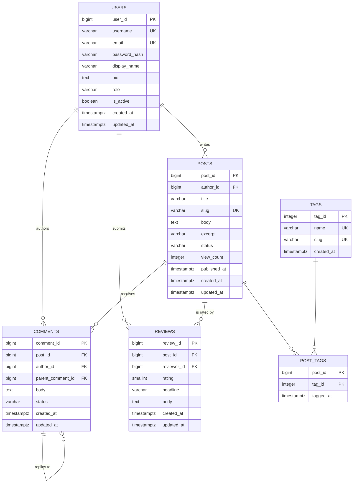

# Database Design Document — Smart Blogging Platform

**Version:** 1.0 · **Date:** 2026-11-01 · **Phase:** 1

---

## 1. Design Decision: Polyglot Persistence

The platform uses **two stores**, each where it is strongest:

| Store | Holds | Why |
|-------|-------|-----|
| **PostgreSQL 16** | `users`, `posts`, `tags`, `post_tags`, `comments`, `reviews` | Structured, highly relational data with hard integrity rules. Authorship, tagging and publication state are all constraint problems, and a relational engine enforces them for free. |
| **MongoDB 7** | `comments`, `reviews` collections | The same two entities, modelled as documents. Comment threads are variable-depth and their metadata is open-ended (edit history, reactions, moderation flags), exactly the shape that forces either a sparse table or an EAV side table in SQL. |

### Why `comments` and `reviews` exist in *both* stores

This is deliberate, not accidental duplication. Epic 4.2 asks for a NoSQL design for
unstructured data **and** an SQL/NoSQL comparison. Implementing the identical entity in
both engines, behind one `CommentDao` interface, turns that comparison from an opinion
into a measurement: Phase 4 runs the same workloads (threaded read, deep insert, keyword
search) against both and records real timings.

The relational version is the system of record for referential integrity; the document
version is the system of record for flexible, nested, write-heavy discussion data. The
active store is selectable at runtime via `app.comments.store` in
`application.properties`.

---

## 2. Conceptual Model

Entities and the business rules that bind them:

- A **User** writes many **Posts**. A post has exactly one author.
- A **Post** carries many **Comments**. A comment belongs to exactly one post.
- A **Comment** may reply to another comment on the same post (self-referencing,
  arbitrary depth).
- A **User** writes many **Comments**. A comment has one author.
- A **Post** has many **Tags**; a **Tag** labels many **Posts** (M:N, resolved by the
  `post_tags` associative entity).
- A **User** may leave at most **one Review** per **Post** (rating 1-5 plus prose).



---

## 3. Logical Model

### 3.1 `users`

| Attribute | Type | Constraints |
|---|---|---|
| user_id | BIGSERIAL | **PK** |
| username | VARCHAR(50) | NOT NULL, **UNIQUE**, CHECK length >= 3 |
| email | VARCHAR(255) | NOT NULL, **UNIQUE**, CHECK format |
| password_hash | VARCHAR(255) | NOT NULL |
| display_name | VARCHAR(100) | NOT NULL |
| bio | TEXT | NULL |
| role | VARCHAR(20) | NOT NULL, CHECK IN (ADMIN, AUTHOR, READER), DEFAULT AUTHOR |
| is_active | BOOLEAN | NOT NULL, DEFAULT TRUE |
| created_at / updated_at | TIMESTAMPTZ | NOT NULL, DEFAULT now() |

### 3.2 `posts`

| Attribute | Type | Constraints |
|---|---|---|
| post_id | BIGSERIAL | **PK** |
| author_id | BIGINT | **FK** to users(user_id) ON DELETE CASCADE, NOT NULL |
| title | VARCHAR(255) | NOT NULL, CHECK not blank |
| slug | VARCHAR(280) | NOT NULL, **UNIQUE** |
| body | TEXT | NOT NULL |
| excerpt | VARCHAR(500) | NULL |
| status | VARCHAR(20) | NOT NULL, CHECK IN (DRAFT, PUBLISHED, ARCHIVED), DEFAULT DRAFT |
| view_count | INTEGER | NOT NULL, DEFAULT 0, CHECK >= 0 |
| published_at | TIMESTAMPTZ | NULL, forced NOT NULL when status = PUBLISHED |
| created_at / updated_at | TIMESTAMPTZ | NOT NULL, DEFAULT now() |

### 3.3 `tags`

| Attribute | Type | Constraints |
|---|---|---|
| tag_id | SERIAL | **PK** |
| name | VARCHAR(50) | NOT NULL, **UNIQUE**, lower-case enforced by CHECK |
| slug | VARCHAR(60) | NOT NULL, **UNIQUE** |
| created_at | TIMESTAMPTZ | NOT NULL, DEFAULT now() |

### 3.4 `post_tags` (associative)

| Attribute | Type | Constraints |
|---|---|---|
| post_id | BIGINT | **PK** (composite), **FK** to posts ON DELETE CASCADE |
| tag_id | INTEGER | **PK** (composite), **FK** to tags ON DELETE CASCADE |
| tagged_at | TIMESTAMPTZ | NOT NULL, DEFAULT now() |

### 3.5 `comments`

| Attribute | Type | Constraints |
|---|---|---|
| comment_id | BIGSERIAL | **PK** |
| post_id | BIGINT | **FK** to posts ON DELETE CASCADE, NOT NULL |
| author_id | BIGINT | **FK** to users ON DELETE SET NULL, NULL (preserves orphaned threads) |
| parent_comment_id | BIGINT | **FK** to comments ON DELETE CASCADE, NULL |
| body | TEXT | NOT NULL, CHECK not blank |
| status | VARCHAR(20) | NOT NULL, CHECK IN (VISIBLE, HIDDEN, FLAGGED), DEFAULT VISIBLE |
| created_at / updated_at | TIMESTAMPTZ | NOT NULL, DEFAULT now() |

### 3.6 `reviews`

| Attribute | Type | Constraints |
|---|---|---|
| review_id | BIGSERIAL | **PK** |
| post_id | BIGINT | **FK** to posts ON DELETE CASCADE, NOT NULL |
| reviewer_id | BIGINT | **FK** to users ON DELETE CASCADE, NOT NULL |
| rating | SMALLINT | NOT NULL, CHECK BETWEEN 1 AND 5 |
| headline | VARCHAR(150) | NULL |
| body | TEXT | NULL |
| created_at / updated_at | TIMESTAMPTZ | NOT NULL, DEFAULT now() |
| | | **UNIQUE (post_id, reviewer_id)** - one review per user per post |

---

## 4. Normalization to 3NF

**1NF** - every column holds a single atomic value. The M:N relationship between posts
and tags is *not* stored as a comma-separated `tags` column on `posts`; it is decomposed
into `post_tags`. Comment threading is a foreign key, not a nested list.

**2NF** - no partial dependency on a composite key. The only composite key in the schema
is `post_tags(post_id, tag_id)`, and its sole non-key attribute `tagged_at` depends on
the whole key (the moment *that tag* was applied to *that post*), not on either half.

**3NF** - no transitive dependencies. `posts` stores `author_id` only; the author's
`username`, `email` and `display_name` live in `users` and are reached by join.
`tags.name` is stored once and referenced by id, so renaming a tag is a single-row
update. `reviews` stores `rating` but no derived `average_rating` is kept on `posts` -
that is computed by aggregate query.

### Documented exceptions

Two columns are denormalized on purpose. Both are deliberate performance trade-offs
rather than oversights:

1. **`posts.view_count`** - derivable from a view-event log, but no such log exists in
   this scope, and an increment-on-read counter is O(1) where `COUNT(*)` over an event
   table is O(n). It is updated through a single service method so it cannot drift.
2. **`posts.excerpt`** - derivable from `body`, but precomputing it stops the list screen
   pulling full post bodies over the wire for every row. Regenerated whenever `body`
   changes.

`posts.slug` and `tags.slug` are *not* denormalization: they are independent, immutable
external identifiers (candidate keys), not copies of `title`/`name`. A post title can be
edited without breaking its public URL.

---

## 5. Index Strategy

Indexes live in `V2__indexes.sql`, separate from the schema, so Phase 4 can benchmark the
database with and without them by simply choosing whether to run that file.

| Index | Table / Expression | Serves |
|---|---|---|
| `idx_posts_author_id` | posts(author_id) | "posts by author" filter; FK join |
| `idx_posts_status_published` | posts(status, published_at DESC) | the default feed query - composite, so one index covers filter **and** sort |
| `idx_posts_title_lower` | posts(LOWER(title)) | case-insensitive exact/prefix title search (US 3.1) |
| `idx_posts_title_trgm` | GIN posts(title gin_trgm_ops) | `ILIKE '%term%'` substring search, which a B-tree cannot serve |
| `idx_posts_search_tsv` | GIN posts(to_tsvector(title, body)) | full-text keyword ranking across the body |
| `idx_posts_created_at` | posts(created_at DESC) | newest-first listing and keyset pagination |
| `idx_tags_name_lower` | tags(LOWER(name)) | tag lookup by name, case-insensitive |
| `idx_post_tags_tag_id` | post_tags(tag_id) | reverse lookup "all posts with this tag" - the composite PK only covers post-first access |
| `idx_comments_post_created` | comments(post_id, created_at) | load a post's comment thread in order |
| `idx_comments_parent` | comments(parent_comment_id) WHERE NOT NULL | partial index; reply resolution, skipping the top-level majority |
| `idx_comments_author` | comments(author_id) | "my comments" |
| `idx_reviews_post_id` | reviews(post_id) | rating aggregate per post |
| `idx_reviews_reviewer` | reviews(reviewer_id) | "my reviews" |

**Rationale for the composite order.** `(status, published_at DESC)` is ordered
equality-column-first: the feed always filters `status = 'PUBLISHED'` and then sorts by
date, so PostgreSQL can seek to the status prefix and read the already-ordered range,
skipping a sort node entirely. Reversed, the index could not serve the filter.

**Indexes deliberately *not* created.** None on `posts.body` alone (always searched
through the tsvector), and none on `users.role`, `posts.status` or `users.is_active`
alone - these are low-cardinality columns where a sequential scan beats an index because
any single value matches a large fraction of the rows.

---

## 6. Referential Integrity Rules

| Relationship | On delete | Reasoning |
|---|---|---|
| posts to users | CASCADE | Removing an author removes the content they authored. |
| comments to posts | CASCADE | A comment has no meaning without its post. |
| comments to users | SET NULL | A deleted account must not silently erase a conversation others replied to; the comment survives as "[deleted user]". |
| comments to comments | CASCADE | Deleting a parent removes its reply subtree. |
| post_tags to posts / tags | CASCADE | Pure association rows. |
| reviews to posts / users | CASCADE | A review is meaningless without either side. |

`updated_at` is maintained by a trigger (`set_updated_at`) rather than by application
code, so it stays correct no matter which client writes.

---

## 7. MongoDB Document Design

### 7.1 `comments`

Modelled **flat with a materialized path**, not as deeply nested subdocuments. Nesting
replies inside their parent makes the 16 MB document limit a real risk on a popular post,
and turns "update one reply" into a whole-document rewrite. The materialized path
(`/661f.../889a.../`) gives subtree reads through a single indexed prefix match while
keeping each comment an independently updatable document.

```js
{
  _id:         ObjectId,
  postId:      NumberLong(42),      // references PostgreSQL posts.post_id
  authorId:    NumberLong(7),
  authorName:  "ada_l",             // denormalized: comment lists never join
  parentId:    ObjectId | null,
  path:        "/661f.../",         // ancestor ids, root-first; "/" at top level
  depth:       1,
  body:        "...",
  status:      "VISIBLE",
  reactions:   { like: 12, insightful: 3 },        // open-ended, schemaless by design
  editHistory: [ { body: "...", editedAt: ISODate } ],
  createdAt:   ISODate,
  updatedAt:   ISODate
}
```

`authorName` is denormalized on purpose: there is no cross-store join available, and a
comment list must not fan out into N PostgreSQL lookups. The service layer refreshes it
on profile rename.

### 7.2 `reviews`

```js
{
  _id:          ObjectId,
  postId:       NumberLong(42),
  reviewerId:   NumberLong(7),
  reviewerName: "ada_l",
  rating:       5,                                  // 1-5, validated
  headline:     "...",
  body:         "...",
  criteria:     { clarity: 5, depth: 4, accuracy: 5 },   // optional, varies per review
  helpfulVotes: 9,
  createdAt:    ISODate,
  updatedAt:    ISODate
}
```

`criteria` is the clearest argument for the document model: an optional, per-review
variable set of sub-scores. In SQL that is either a wide sparse table or an EAV side
table; in a document it is just a field.

### 7.3 Mongo indexes

| Index | Serves |
|---|---|
| `{ postId: 1, createdAt: 1 }` | load a thread in order |
| `{ postId: 1, path: 1 }` | subtree / reply-chain reads via prefix match |
| `{ parentId: 1 }` | direct children |
| `{ authorId: 1, createdAt: -1 }` | a user's comment history |
| `{ body: "text" }` | keyword search inside comments |
| `{ postId: 1, reviewerId: 1 }` **unique** | mirrors the SQL one-review-per-user rule |
| `{ postId: 1, rating: -1 }` | rating distribution per post |

Schema validation is enforced with `$jsonSchema` at `validationLevel: "strict"`, so the
"schemaless" store still rejects malformed data: flexibility where it is wanted
(`reactions`, `criteria`), rigidity where it is needed (`postId`, `rating`).

---

## 8. Capacity and Growth Notes

- `posts.post_id` and `comments.comment_id` are `BIGSERIAL`: comment volume is the
  fastest-growing dimension, and a 32-bit ceiling is a foreseeable defect.
- `tags.tag_id` stays `SERIAL` - a tag vocabulary is bounded in the thousands.
- All timestamps are `TIMESTAMPTZ`, never `TIMESTAMP`: readers sit in multiple timezones
  and a naive timestamp silently loses that.
- Seed data is generated at roughly 500 posts and 5 000 comments so that Phase 4 index
  benchmarks measure something real. A 20-row table is index-immune.

---

## 9. Open Items for Later Phases

- Keyset (cursor) pagination alongside `LIMIT/OFFSET` - Phase 4, deep-page performance.
- Materialized view for per-post rating aggregates, if the live `AVG` proves slow -
  Phase 4, and only if measured.
- Full-text search weighting (title above body) once the tsvector index is benchmarked.
