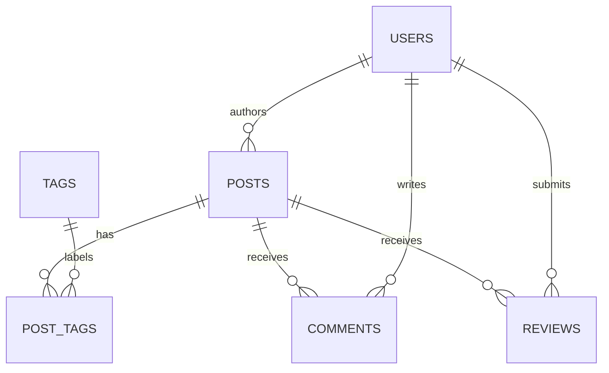

# Database design

[Back to the README](../README.md)

## Conceptual model

A user authors posts. Posts and tags have a many-to-many relationship through `post_tags`. Users can comment on posts and leave one review per post. Comments and reviews reference PostgreSQL IDs from MongoDB.

## PostgreSQL logical and physical model

All columns are required. See the [schema](../db/postgres/schema.sql) and [index script](../db/postgres/indexes.sql).

| Table | Attributes and constraints |
|---|---|
| `users` | `user_id BIGSERIAL` primary key. Unique `username VARCHAR(50)` and `email VARCHAR(255)`. `password_hash VARCHAR(64)` stores a SHA-256 hex digest. Also includes `display_name VARCHAR(100)`, `role VARCHAR(10)` restricted to `ADMIN`, `AUTHOR`, or `READER`, and `created_at TIMESTAMP DEFAULT now()`. |
| `posts` | `post_id BIGSERIAL` primary key and `author_id BIGINT` foreign key to `users`. `title VARCHAR(200)` must be nonblank after trimming. Also includes `body TEXT`, `created_at TIMESTAMP DEFAULT now()`, and `updated_at TIMESTAMP DEFAULT now()`. The DAO sets `updated_at` on edits. |
| `tags` | `tag_id BIGSERIAL` primary key and unique `name VARCHAR(50)`. The app trims and lowercases names. |
| `post_tags` | `post_id BIGINT` and `tag_id BIGINT` reference `posts` and `tags`. Their composite primary key prevents duplicate assignments. |

Foreign keys cascade on delete. Deleting a post or tag removes its rows from `post_tags`. Deleting a user in PostgreSQL cascades to their posts and their posts’ tag links. When the app deletes a post, the service removes its MongoDB comments and reviews before deleting the SQL row. Those writes span two databases and run as separate operations.

### Normalization

- **1NF.** A post’s tags are stored as individual rows in `post_tags`.
- **2NF.** Both columns in `post_tags` form its key. Each other table has a single-column primary key.
- **3NF.** Account details are stored in `users` and joined through `author_id`. Tag names are stored in `tags` and resolved through `post_tags`. Non-key attributes describe the entity identified by the table’s key.

### Indexes

| Index | Purpose |
|---|---|
| `idx_posts_author_id` | Filter posts by author. |
| `idx_posts_title_trgm`, `idx_posts_body_trgm` | Support case-insensitive substring search with `ILIKE` and `pg_trgm`. |
| `idx_post_tags_tag_id` | Find posts for a tag. The composite primary key starts with `post_id`. |
| `idx_posts_created_at` | Read the newest posts in order. |
| Primary-key and unique indexes | Cover ID lookups and enforce uniqueness for tag names, usernames, and emails. |

## MongoDB document model

The [MongoDB setup script](../db/mongo/setup.js) defines collection validators and indexes.

| Collection | Document fields | Index |
|---|---|---|
| `comments` | `_id` (ObjectId), `postId` and `authorId` (BSON long), `authorName` (string), nonempty `body` (string), `createdAt` (date). | `{ postId: 1, createdAt: 1 }` loads comments in chronological order. |
| `reviews` | `_id` (ObjectId), `postId` and `reviewerId` (BSON long), `reviewerName` (string), `rating` (integer 1–5), optional `text` (string), `createdAt` (date). | Unique `{ postId: 1, reviewerId: 1 }` enforces one review per user per post. |

PostgreSQL uses foreign keys and transactions for authorship and tag assignments. MongoDB keeps each comment or review and its display name in one document, with `$jsonSchema` enforcing the expected types. Keeping all entities in SQL would allow foreign keys from comments and reviews to posts and users. The split model handles those references and post deletion in the application.
